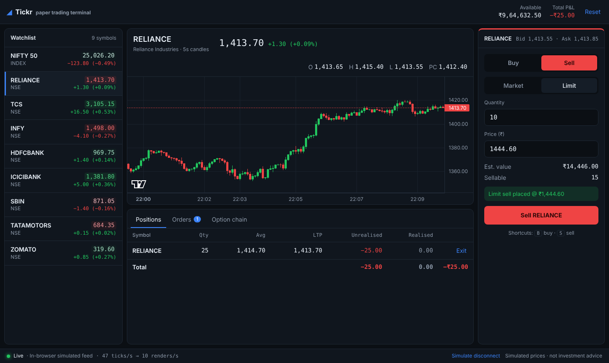

# Tickr — real-time trading terminal

A paper-trading terminal for NSE-style markets, built to explore the hard parts of trading frontends: **live prices that update many times a second without jank, numbers that are always exactly right, and order flows that handle every edge case.**

> Prices are simulated. No real money, no real market data.



**Live demo:** _add your Vercel/Netlify link here_

## Features

| | |
|---|---|
| **Live watchlist** | 9 symbols streaming ~50 ticks/s, green/red flash on every change, skeleton loading state |
| **Candlestick chart** | 5-second candles built client-side from ticks (TradingView Lightweight Charts), history back-filled to join live data seamlessly |
| **Order ticket** | Market & limit, buy & sell, live validation: funds, holdings, ₹0.05 tick size, ±20% price band. `B` / `S` keyboard shortcuts |
| **Order matching** | Limit orders rest in the book and fill when the price crosses; cash is blocked for open buys, shares reserved for open sells |
| **Positions & P&L** | Weighted average price, live unrealised and realised P&L, one-click exit |
| **Option chain** | NIFTY 50 chain priced with Black–Scholes + a volatility smile; ITM shading, ATM highlight, spot marker, live delta |
| **Resilient feed** | WebSocket with exponential backoff + jitter, heartbeat-based "stale" detection, a "Simulate disconnect" button to demo it |
| **States** | Loading, empty and error states for every panel; per-panel error boundaries |

## Engineering decisions (the interesting bit)

**1. Prices live outside React, and renders are batched per frame.**
A naive `useState`/Context store re-renders the whole tree on every tick. Here, `PriceStore` keeps quotes in a plain `Map`; each watchlist row subscribes to *only its own symbol* via `useSyncExternalStore`. Ticks arriving within the same animation frame are coalesced, so a row renders at most once per frame no matter how fast the feed is. The status bar shows this live: `55 ticks/s → 10 renders/s`.

**2. Coalescing never loses data.**
Rendering only the latest price per frame is fine for display, but a candle's high/low or a limit order's fill must see *every* tick. Those consumers subscribe to the raw stream (`onRawTick`), while the chart is still only redrawn once per frame.

**3. Money is integer paise, end to end.**
`0.1 + 0.2 !== 0.3` in JavaScript. All prices are stored as integer paise and only converted to rupees when formatting. User input is parsed with a regex straight into paise, never through `parseFloat`. Positions store total cost rather than average price so repeated buys/sells can't accumulate rounding drift.

**4. The trading engine is pure functions.**
`placeOrder`, `matchOpenOrders`, `cancelOrder` take state and return new state. No React, no side effects — so it is fully unit-tested and the UI can never half-apply a fill.

**5. The chart is driven imperatively.**
The chart is created once; new candles go to `series.update()` directly instead of through React state, avoiding re-diffing hundreds of bars on every tick.

**6. Never trust the wire.**
Incoming messages are validated (`parseServerMessage`); malformed quotes are dropped and out-of-order ticks are ignored rather than moving the price backwards. The server skips slow clients whose socket buffer is backed up (backpressure).

## Architecture

```
server/feed-server.ts ──WebSocket──┐
                                   ├─► MarketFeed (reconnect, heartbeat, stale) ─► PriceStore
SimulatedTransport (in-browser) ───┘                                               │
                                          ┌──── raw ticks ───────────────────────────┤
                                          ▼                                          ▼ once per frame
                                candleStore · order matching             useQuote(symbol) → rows, chart, P&L
```

Both transports speak the same protocol (`src/feed/protocol.ts`) and share one simulator (geometric Brownian motion, seeded PRNG), so the deployed demo needs no backend.

## Run it

```bash
npm install
npm run dev          # in-browser simulated feed → http://localhost:5173

# or with the real WebSocket server
npm run server       # terminal 1: ws://localhost:8787
npm run dev:ws       # terminal 2

npm test             # 46 unit + component tests (Vitest, React Testing Library)
npm run build
```

## Tech

React 19 · TypeScript (strict) · Vite · Lightweight Charts · `ws` (Node WebSocket server) · Vitest · React Testing Library

## What I'd build next

- Virtualised watchlist for 500+ symbols
- Move tick parsing into a Web Worker
- Market depth (top-5 bid/ask) ladder
- Trading options directly from the chain, with lot sizes
- Playwright end-to-end test of the buy → position → exit flow
- React Native version sharing the engine and stores
